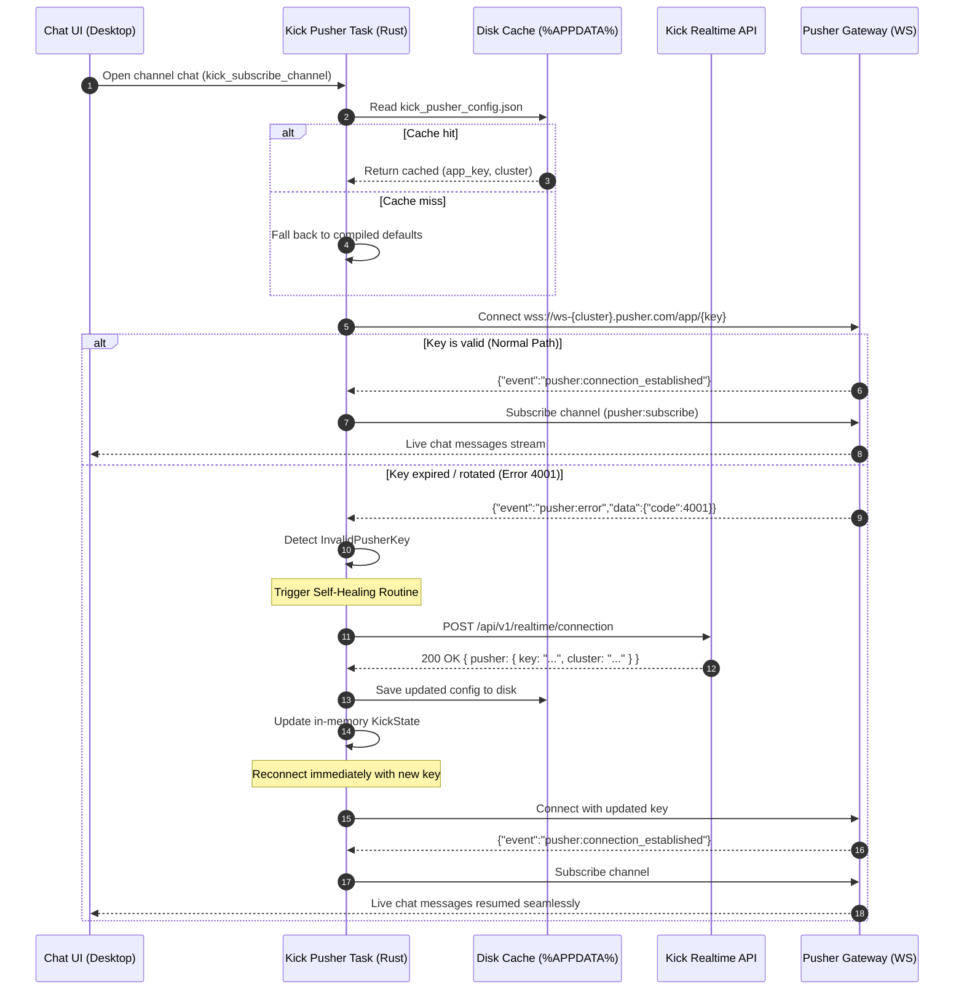

# Kick Credentials & WebSocket Self-Healing Architecture

## 1. Executive Summary & Design Overview

Kick's live chat integration in Multistream relies on real-time WebSocket subscriptions over the Pusher protocol (`ws-{cluster}.pusher.com`). Unlike officially documented, fixed enterprise APIs, Kick's public client endpoints periodically rotate their application credentials (`app_key`) and cluster assignments without public warning or deprecation schedules.

Previously, Multistream utilized static, hardcoded credentials compiled directly into the binary. When Kick rotated its primary frontend key from `32cbd69e4b950bf97679` to `34bf7a0ff419a2a775b9`, existing installations suffered continuous reconnect loops and non-functional Kick chat until a new desktop build was released and installed by users.

To eliminate this vulnerability permanently, Multistream features a **Reactive Self-Healing Architecture** paired with a **Two-Tier Persistent Cache**. The application boots instantly using cached credentials, detects Pusher protocol rejections (error code `4001`), dynamically negotiates the newest credentials from Kick's internal realtime negotiation endpoint via Rust, persists them to the local operating system profile, and reconnects seamlessly with zero human intervention.

---

## 2. The Problem: Static Keys in Dynamic Upstream Ecosystems

### 2.1 The Failure Mode (Pusher Error 4001)

Kick chat connections establish a WebSocket handshake to Pusher with the following URL structure:

```text
wss://ws-{cluster}.pusher.com/app/{app_key}?protocol=7&client=js&version=8.4.0-rc2&flash=false
```

When an `app_key` is revoked or rotated by Kick, Pusher immediately terminates the handshake frame and responds with an application-level error message:

```json
{
  "event": "pusher:error",
  "data": {
    "code": 4001,
    "message": "App key 32cbd69e4b950bf97679 not found"
  }
}
```

Prior to self-healing:
1. The WebSocket client perceived this termination as a transient network disconnect.
2. The client scheduled an exponential backoff reconnection attempt (5s delay).
3. The next attempt used the same invalid key, triggering another `4001` error.
4. The user was caught in an **infinite reconnection loop**, chat messages were never received or sent, and logs were inundated with failed connection cycles.

### 2.2 The Maintenance Burden (Release Fatigue)

In a traditional desktop architecture without self-healing:
- A key rotation requires manual developer discovery (often reported by frustrated users).
- A developer inspects Kick's compiled frontend bundles to reverse-engineer the new key.
- A commit is pushed, CI/CD builds artifacts for Windows, macOS, and Linux (~25–40 minutes).
- Users must download, install, and restart the application.

This operational cycle introduces hours or days of platform downtime for an issue as simple as a 20-character string change.

---

## 3. Historical Implementation (How It Worked Before)

Previously, `apps/desktop/src-tauri/src/kick/pusher.rs` defined the Pusher connection parameters as immutable compiled constants:

```rust
// Legacy implementation (apps/desktop/src-tauri/src/kick/pusher.rs)
const PUSHER_KEY: &str = "32cbd69e4b950bf97679";
const PUSHER_CLUSTER: &str = "us2";

fn get_pusher_url() -> String {
    format!(
        "wss://ws-{}.pusher.com/app/{}?protocol=7&client=js&version=8.4.0-rc2&flash=false",
        PUSHER_CLUSTER, PUSHER_KEY
    )
}
```

### Limitations:
1. **Zero Runtime Adaptability:** If Kick invalidated `PUSHER_KEY`, 100% of deployed clients broke instantly.
2. **No Protocol-Level Error Inspection:** The socket loop discarded error bodies during handshake and treated all closures identically.
3. **No Storage State:** The client possessed no persistent configuration cache to receive updates dynamically.

---

## 4. The Self-Healing Architecture

Multistream's self-healing pipeline combines three layers:
1. **Protocol Inspection:** Intercepts Pusher error payloads (`4001` / `4003`) before standard connection retries.
2. **Upstream Negotiation:** Queries Kick's internal realtime negotiation endpoint via Rust with Cloudflare-bypass TLS (`rustls`).
3. **Multi-Tier Persistence:** Caches new credentials in-memory and writes them to `%APPDATA%\multistream\kick_pusher_config.json`.

```
┌────────────────────────────────────────────────────────────────────────┐
│                        Kick Chat Connect Flow                          │
└───────────────────────────────────┬────────────────────────────────────┘
                                    │
                                    ▼
                     ┌─────────────────────────────┐
                     │ 1. Resolve Pusher Config    │
                     │  - Memory (KickState)       │
                     │  - Disk (%APPDATA% cache)   │
                     │  - Compiled Defaults        │
                     └──────────────┬──────────────┘
                                    │
                                    ▼
                     ┌─────────────────────────────┐
                     │ 2. Pusher Handshake Attempt │
                     └──────────────┬──────────────┘
                                    │
                 ┌──────────────────┴──────────────────┐
                 │ Handshake OK                        │ Handshake Error (4001 / 4003)
                 ▼                                     ▼
   ┌───────────────────────────┐         ┌───────────────────────────────┐
   │ 3. Subscribe & Stream     │         │ 4. Trigger Self-Healing       │
   │    Kick Chat Events       │         │    Fetch Upstream Config      │
   └───────────────────────────┘         └───────────────┬───────────────┘
                                                         │
                                                         ▼
                                         ┌───────────────────────────────┐
                                         │ POST /api/v1/realtime/        │
                                         │ connection (reqwest + rustls) │
                                         └───────────────┬───────────────┘
                                                         │
                                                         ▼
                                         ┌───────────────────────────────┐
                                         │ 5. Update Memory & Disk Cache │
                                         │    Reconnect Immediately      │
                                         └───────────────────────────────┘
```

### 4.1 Reactive Error Interception

During the initial handshake phase, Pusher transmits connection errors as text messages before closing the TCP socket. In `apps/desktop/src-tauri/src/kick/pusher.rs`, `check_handshake_message` parses early incoming frames:

```rust
fn check_handshake_message(msg: &str) -> Result<(), KickError> {
    if let Ok(val) = serde_json::from_str::<serde_json::Value>(msg) {
        if val.get("event").and_then(|v| v.as_str()) == Some("pusher:error") {
            let code = val.get("data")
                .and_then(|d| d.get("code"))
                .and_then(|c| c.as_u64())
                .unwrap_or(0);

            // 4001: App key does not exist
            // 4003: Cluster does not exist
            if code == 4001 || code == 4003 {
                return Err(KickError::InvalidPusherKey(format!(
                    "Pusher rejected key/cluster with error code {}", code
                )));
            }
        }
    }
    Ok(())
}
```

When `InvalidPusherKey` is caught by `run_pusher_loop`, the client transitions to discovery instead of waiting for standard exponential backoff.

### 4.2 Dynamic Upstream Key Negotiation

Kick's web client discovers its real-time transport and credentials dynamically via an internal HTTP endpoint:

- **Method:** `POST`
- **URL:** `https://web.kick.com/api/v1/realtime/connection`
- **Headers:**
  - `Content-Type: application/json`
  - `Accept: application/json`
  - `User-Agent: Mozilla/5.0 (Windows NT 10.0; Win64; x64) AppleWebKit/537.36...`

#### Request Payload
By default, Kick responds with Centrifugo connection parameters. To receive Pusher credentials, the client specifies `pusher` in `capabilities.accepted_providers`:

```json
{
  "client": {
    "id": "3fa85f64-5717-4562-b3fc-2c963f66afa6",
    "type": "web"
  },
  "capabilities": {
    "accepted_providers": [
      {
        "provider": "pusher"
      }
    ]
  }
}
```

#### Upstream Response Schema
```json
{
  "data": {
    "provider": "pusher",
    "pusher": {
      "key": "34bf7a0ff419a2a775b9",
      "cluster": "us2"
    }
  }
}
```

#### Cloudflare & TLS Fingerprinting (rustls)
Kick protects `web.kick.com` with Cloudflare anti-bot systems. Standard native TLS libraries (such as Windows `Schannel` used by default `reqwest`) generate TLS Client Hello fingerprints flagged with HTTP 403 Forbidden. Multistream executes all Kick API requests through a global Rust HTTP client configured strictly with `rustls-tls`:

```rust
// apps/desktop/src-tauri/src/kick/api.rs
pub async fn fetch_realtime_pusher_config(client: &Client) -> Result<KickPusherConfig, KickError> {
    let payload = serde_json::json!({
        "client": {
            "id": uuid::Uuid::new_v4().to_string(),
            "type": "web"
        },
        "capabilities": {
            "accepted_providers": [{ "provider": "pusher" }]
        }
    });

    let res = client
        .post("https://web.kick.com/api/v1/realtime/connection")
        .header("Content-Type", "application/json")
        .header("Accept", "application/json")
        .json(&payload)
        .send()
        .await?;

    let text = res.text().await?;
    parse_realtime_pusher_response(&text)
}
```

### 4.3 Multi-Tier Storage & Resilience Pipeline

Multistream uses a 3-tier fallback hierarchy to guarantee zero boot latency while keeping credentials up to date:

| Tier | Layer | Location | Latency | Mutability |
| :--- | :--- | :--- | :--- | :--- |
| **Tier 1** | In-Memory State | `KickState.pusher_config` (`Arc<RwLock<Option<KickPusherConfig>>>`) | <1 µs | Runtime read/write |
| **Tier 2** | Persistent Disk Cache | `%APPDATA%\multistream\kick_pusher_config.json` | ~1 ms | Persisted across app restarts |
| **Tier 3** | Compiled Defaults | `DEFAULT_PUSHER_KEY` & `DEFAULT_PUSHER_CLUSTER` in `pusher.rs` | 0 ms | Immutable fallback |

#### Path Resolution & Environment Isolation
To avoid collisions during testing and development, cache paths are isolated according to build profile:
- **Production:** `%APPDATA%\multistream\kick_pusher_config.json` (Windows) / `~/.config/multistream/kick_pusher_config.json` (Linux/macOS)
- **Development (`#[cfg(debug_assertions)]`):** `kick_pusher_config_dev.json`

```rust
// Disk cache persistence in pusher.rs
fn save_pusher_config_to_cache(config: &KickPusherConfig) {
    if let Some(mut path) = dirs::config_dir() {
        path.push("multistream");
        let filename = if cfg!(debug_assertions) {
            "kick_pusher_config_dev.json"
        } else {
            "kick_pusher_config.json"
        };
        path.push(filename);
        if let Ok(json) = serde_json::to_string_pretty(config) {
            let _ = std::fs::write(path, json);
        }
    }
}
```

### 4.4 Concurrency Control (Stampede Prevention) & Upstream Backoff

To prevent redundant HTTP requests when multiple subscription tasks or rapid channel switches encounter an expired key simultaneously, `KickState` enforces two synchronization safeguards:

1. **Double-Checked Locking (`pusher_heal_lock`):**
   - `heal_pusher_config` acquires `state.pusher_heal_lock.lock().await` before performing any network I/O.
   - Once inside the lock, it compares `state.pusher_config` against `failed_config`. If another task already healed the credentials while this task was waiting, it immediately reuses the new in-memory configuration and returns `true` without firing a duplicate HTTP request.
2. **Upstream Exponential Cooldown (`PusherHealBackoff`):**
   - If `POST https://web.kick.com/api/v1/realtime/connection` fails (e.g., network outage, HTTP 500, or Cloudflare 403 block) or returns the same broken key, `PusherHealBackoff` records the failure in `KickState` and enforces a progressive cooldown across loop restarts:
     - **1st failure:** `5s` cooldown
     - **2nd failure:** `15s` cooldown
     - **3rd failure:** `30s` cooldown
     - **4th+ failure:** `60s` max cap
   - Any successful key rotation immediately resets the failure counter and cooldown via `record_success()`.
   - Additionally, `run_pusher_loop` reserves `Duration::ZERO` reconnect delay strictly for `healed == true`; unhealed failures always wait at least `2s + jitter` before reconnecting.

---

## 5. End-to-End Self-Healing Flowchart



---

## 6. Developer CLI Tooling (`kick:check`)

To inspect, audit, and force-refresh Kick credentials outside the Tauri runtime, Multistream includes a developer CLI script in `scripts/check-kick-keys.ts`.

### Usage

```bash
# Check current credentials against Kick upstream and test live Pusher handshake:
bun run kick:check

# Force upstream negotiation and overwrite local disk cache:
bun run kick:check --fix
```

### Operational Steps performed by `kick:check`:
1. **Upstream Discovery:** Sends `POST https://web.kick.com/api/v1/realtime/connection` with realistic browser headers and UUID payload.
2. **Handshake Verification:** Connects to Pusher WebSocket using the discovered credentials, verifies `pusher:connection_established`, and closes the socket cleanly.
3. **Local Cache Comparison:** Reads `%APPDATA%\multistream\kick_pusher_config.json` and reports whether the local cache is synced, stale, or absent.
4. **Source Code Parity:** Compares discovered key with compiled constants in `apps/desktop/src-tauri/src/kick/pusher.rs`.
5. **Disk Write (`--fix`):** Saves the fresh credentials to the disk cache so subsequent desktop app runs boot immediately with the new key.

---

## 7. Future Considerations & Long-Term Roadmap

### 7.1 Kick's Migration to Centrifugo

During the reverse-engineering of `POST https://web.kick.com/api/v1/realtime/connection`, discovery revealed that Kick's default realtime transport has transitioned upstream to **Centrifugo**:

```json
{
  "data": {
    "provider": "centrifugo",
    "centrifugo": {
      "url": "wss://realtime.us-west-2.platform.kick.com/connection/websocket",
      "token": "eyJhbGciOiJIUzI1NiIsInR5cCI6IkpXVCJ9..."
    }
  }
}
```

#### Strategic Implications:
1. **Pusher Compatibility Deprecation:** Kick currently maintains backwards compatibility with Pusher via `accepted_providers: [{ provider: "pusher" }]`. However, Kick may sunset Pusher entirely in the future.
2. **Preparedness:** Because Multistream's self-healing infrastructure already communicates directly with Kick's realtime negotiation API, migrating to Centrifugo in the future requires only:
   - Implementing a lightweight Centrifugo protocol client in `apps/desktop/src-tauri/src/kick/centrifugo.rs`.
   - Switching the provider request payload from `pusher` to `centrifugo`.
   - Managing token refresh cycles when Kick JWT tokens expire.

The self-healing architecture decouples Multistream from any single third-party WebSocket transport.

### 7.2 Anti-Bot & Cloudflare Protection Shifts

Kick frequently modifies Cloudflare WAF rules:
- **Header Strictness:** The negotiation endpoint requires realistic browser headers. If Cloudflare tightens Turnstile or JavaScript challenges on `/api/v1/realtime/connection`, direct HTTP negotiation from the Rust backend may encounter 403 blocks.
- **Mitigation Strategy:** If HTTP requests ever fail due to WAF challenges, the architecture falls back to cached credentials on disk, allowing developer synchronization via `bun run kick:check --fix` or embedding an invisible WebView fallback challenge solver if strictly necessary.

### 7.3 Cache Invalidation and Corruption Resilience

- If `kick_pusher_config.json` is corrupted, deleted, or contains malformed JSON, `pusher.rs` gracefully logs a warning, skips the corrupt cache, and falls back to compiled defaults without crashing.
- File writes use safe atomic overwrites to prevent half-written configuration files during unexpected OS shutdowns.

---

## 8. Source Code & Component Reference

| Component | File Path | Responsibility |
| :--- | :--- | :--- |
| **Error Definitions** | [`apps/desktop/src-tauri/src/kick/error.rs`](file:///d:/Estudos/Projetos/multistream/apps/desktop/src-tauri/src/kick/error.rs) | `KickError::InvalidPusherKey` enum variant |
| **State & Models** | [`apps/desktop/src-tauri/src/kick/state.rs`](file:///d:/Estudos/Projetos/multistream/apps/desktop/src-tauri/src/kick/state.rs) | `KickPusherConfig` struct and `KickState` thread-safe fields |
| **Discovery API** | [`apps/desktop/src-tauri/src/kick/api.rs`](file:///d:/Estudos/Projetos/multistream/apps/desktop/src-tauri/src/kick/api.rs) | `fetch_realtime_pusher_config` & response parser |
| **WebSocket Loop** | [`apps/desktop/src-tauri/src/kick/pusher.rs`](file:///d:/Estudos/Projetos/multistream/apps/desktop/src-tauri/src/kick/pusher.rs) | Handshake error inspection, self-healing loop, disk caching |
| **Developer CLI** | [`scripts/check-kick-keys.ts`](file:///d:/Estudos/Projetos/multistream/scripts/check-kick-keys.ts) | Upstream audit, WebSocket handshake verification, `--fix` cache sync |
| **Documentation** | [`docs/kick-credentials-self-healing.md`](file:///d:/Estudos/Projetos/multistream/docs/kick-credentials-self-healing.md) | Full architectural specification |
